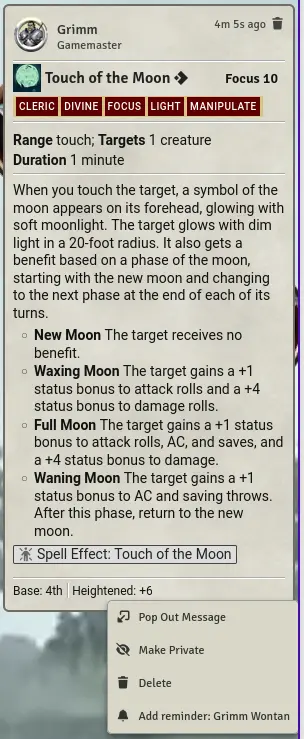
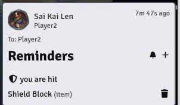
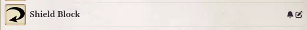
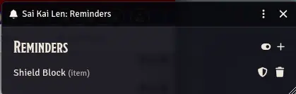
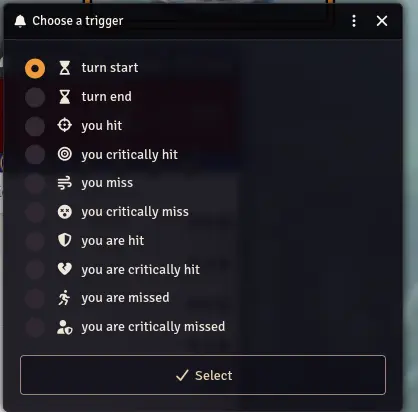

# PF2e Robin's Reminders

Private, per-user reminders for Pathfinder 2e in Foundry VTT. Get reminded of sustained spells, auras and durations at the start or end of your turn, or when you hit, miss, or are hit or missed.

## What It Does
- Adds a reminder from a chat message, an item on an actor sheet, or free text
- Posts your reminders as a private chat message (whispered only to you) when they fire
- Fires on **turn start**, **turn end**, or one of eight attack triggers (hit, critical hit, miss, ... for you or against you)
- Stores everything per user: private to you, kept between encounters until you remove it
- Lets you turn reminders off per actor, or for the whole module

## Installation
1. In Foundry, open **Add-on Modules**.
2. Click **Install Module**.
3. Search for PF2e Robin's Reminders  
    or  
Paste this manifest URL:
   - `https://github.com/robinsving/pf2e-reminders/releases/latest/download/module.json`
4. Install and enable the module in your world.

Requires Foundry v14 and the Pathfinder 2e system.

## Usage
### 1. Add a reminder from a chat message
Right-click any chat message (a spell card, an effect, a condition, ...) and pick **Add reminder: &lt;actor name&gt;**. A popup asks which trigger it should fire on (see [Triggers](#triggers)).

- The actors listed are your selected tokens, otherwise your combatants, otherwise your tokens on the scene, otherwise your assigned character (the GM only gets non-player actors).
- The entry is only offered when there is such an actor.

### 2. Get the reminders
When a reminder fires, a private chat message lists your reminders for that trigger and actor. A subheader under the title shows the trigger as an icon and text, and each reminder has a trash icon to remove it. Nothing is posted if there is nothing to show.

- When the turn passes from one combatant to the next, the end of the old turn comes before the start of the new one.
- Only the newest message of a trigger is active; older ones are marked as past.
- The right side of the title line has a **+** to type a custom reminder for the message's actor and trigger, and a bell that opens the actor's reminders window (the same bell as on the sheets).

### 3. Add a reminder from a character sheet
Every item row on an actor sheet (feats, actions, spells, effects, ...) gets a bell icon when you own the actor. Click it to add a reminder for that item, for example an aura or a sustained effect; a popup asks which trigger it fires on. Click the bell again to remove the item's reminders.

- The bell goes in the row's icon list on the right, also on NPC abilities and strikes.
- The reminder belongs to that actor and fires on the trigger you pick. Its text opens the item sheet.
- **Item reminder bells** > **Choose item types** in the module settings lets you tick which kinds of items get a bell. By default only actions, afflictions, effects, feats and spells do; tick conditions, equipment and so on if you want them too. Some types can never have one: those the sheets show no icon list for (ancestry, background, class, heritage, deity, kits and campaign features), lore skills, and spellcasting entries such as "Arcane Prepared Spells". The choice is per browser; reopen open sheets to see a change. If you have saved a choice before, it is kept.
- NPC sheets get no bells and no **Reminders** button (also not in the combat tracker menu) by default, and NPCs are left out of the chat menu's actor list. The GM can turn them on with the world setting **Reminders for NPCs**.

### 4. The actor's reminders window
Open it from the **Reminders** button in the actor sheet header, or by right-clicking a combatant in the combat tracker and choosing **Reminders**. It lists your reminders for that actor, lets you add a custom one or remove any, and has a toggle to turn the actor's reminders on or off.

- Reminders are on for every actor by default (nothing shows until you add one). Turn an actor off to keep its reminders stored but silent; this covers all triggers and is also per user.
- For an unlinked token (most NPCs) the toggle only affects that token; for a linked token or an actor from the Actors tab it covers all tokens of the actor.
- Reminders stored without an actor, left over from earlier versions, still show for all your actors until you remove them in **Manage reminders**.

### 5. Manage all your reminders
**Manage reminders** in the module settings lists all your stored reminders, grouped per actor or token in collapsed sections you can expand. You can remove single reminders, or all reminders of one actor, token or the leftover group without an actor with that heading's **Remove all**.

- Click a reminder's text to pop the original chat message (or item sheet) out with Foundry's built-in windows. If it was deleted you get a warning instead.
- **Clear all reminders** at the bottom does a full reset after a confirmation. It removes all your reminders and on/off settings, and also clears leftover reminders that older versions stored on actors you own.

## Triggers
A reminder fires on a trigger. New reminders ask which one; reminders from earlier versions have no trigger and count as turn start.

| Trigger | Icon | Fires |
|---|---|---|
| turn start (default) | hourglass, start | at the start of the actor's turn |
| turn end | hourglass, end | at the end of the actor's turn |
| you hit | crosshair | when the actor's attack hits or critically hits |
| you critically hit | bullseye | when the actor's attack critically hits |
| you miss | wind | when the actor's attack misses or critically misses |
| you critically miss | dizzy face | when the actor's attack critically misses |
| you are hit | shield | when an attack against the actor hits or critically hits |
| you are critically hit | broken heart | when an attack against the actor critically hits |
| you are missed | running person | when an attack against the actor misses or critically misses |
| you are critically missed | shield with a person | when an attack against the actor critically misses |

- Each reminder in the actor's reminders window and in **Manage reminders** has its trigger icon. Hover it to see the trigger, click it to open a popup where you choose another. The subheader of a reminders message shows the trigger as an icon and text too.
- The custom reminder prompt (the **+**) has the same icon next to the text field, starting on the trigger of the list you opened it from.
- The attack triggers fire right after a PF2e attack roll (strike or spell attack) against a target, as a private message like the turn ones. Hit and miss include their critical versions; critical hit and critical miss only fire on those.
- Only actors you own count, and the roll needs a target: an attack without one has no outcome.
- A reroll that changes the outcome does not fire anything.

## Settings
- **Enable reminders** (client, on by default): turns every feature off for you: the chat menu entries, the sheet bells and **Reminders** button, the combat tracker entry and the reminders messages. Your stored reminders are kept, and **Manage reminders** still works.
- **Reminders for NPCs** (world, GM, off by default): turns the reminder features on for NPC actors.
- **Item reminder bells** > **Choose item types** (client): which kinds of items get a bell.
- **Manage reminders**: see [above](#5-manage-all-your-reminders).
- **Debug logging** (client): prints debug messages to the browser console, see [Troubleshooting](#troubleshooting).

## Troubleshooting
- The module always logs to the browser console when it registers its hooks and when it has initialized and is ready.
- Turn on **Debug logging** to also print a summary at startup (version, settings, number of stored reminders, registered hooks), template loading, every change to your stored reminders, and each reminders message that is posted.
- If there is no bell or **Reminders** button for an NPC, check the world setting **Reminders for NPCs**. If an attack trigger does not fire, check that the attack had a target and that you own the actor.

## Development
- Test suite: `npm test`
- Build and copy into the local Foundry instance: `npm run build-and-apply`

## Compatibility
Foundry v14 and the Pathfinder 2e system.

## Support
- Issues: https://github.com/robinsving/pf2e-reminders/issues

## License
MIT. See the [LICENSE](LICENSE) file.
